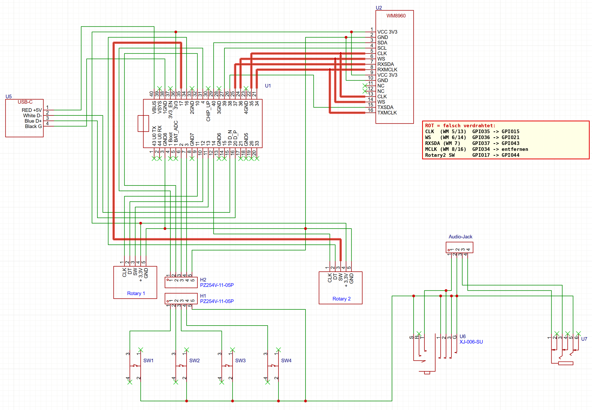

# Verkabelung NR_Intercom Bodypack

> **Hinweis (neuer Stand):** Diese Seite beschreibt den **ersten Aufbau** (WM8960 direkt am ESP32-S3).
> Inzwischen übernimmt ein **ESP32-C5-Zero** Funk und Audio, der WM8960 hängt am C5, und der S3 macht nur noch Display und Drehgeber.
> Aktuelle Verdrahtungspläne: [C5 + WM8960 + Tasten](img/verkabelung-c5-wm8960.png) · [S3 + Drehgeber](img/verkabelung-s3-drehgeber.png).
> Die Hinweise zu PSRAM-Pins, Display-Reset (GPIO17) und MCLK gelten weiterhin.

Stand: Prüfung des Schaltplans `img/bodypack-schaltplan-original.png`.
Die Leitungen wurden automatisch aus dem Bild nachverfolgt und von Hand gegengeprüft.

> **Achtung, der Schaltplan ist nicht ganz aktuell:** Laut dem Arduino-Sketch im NR_Com-Repo
> (`wm8960/wm8960_full_loopback`) wurde **Drehgeber 2 SW schon von GPIO17 auf GPIO15** umgelötet.
> Die Soll-Belegung unten geht von diesem Stand aus. **Bitte mit dem Multimeter prüfen, was wirklich verdrahtet ist.**

## Hardware

| Teil | Bezeichnung |
|---|---|
| MCU / Display | Waveshare ESP32-S3 AMOLED-Board (ESP32-S3**R8**, 8 MB Octal-PSRAM, QSPI-AMOLED, QMI8658, TF-Karte, 2× 20-Pin-Leisten H1/H2). Nach dem Schaltplan vermutlich das **ESP32-S3-(Touch-)AMOLED-1.91** → **bitte bestätigen** |
| Audio | Waveshare WM8960 Audio Board (I2C-Steuerung, I2S-Audio, eigener 24-MHz-Quarzoszillator) |
| Bedienung | 2× KY-040 Drehgeber (CLK/DT/SW), 4× Taster SW1–SW4 |
| Sonstiges | externe USB-C-Buchse (U5), Headset-Buchsen U6/U7 |

Pin-Nummern „U1-xx“ beziehen sich auf die Nummerierung in deinem Schaltplan:
U1-1…20 = Leiste **H1** Pin 1…20, U1-21…40 = Leiste **H2** Pin 20…1.

---

## ⚠️ Gefundene Fehler (müssen umgelötet werden)

### 1. I2S liegt auf GPIO34–37 → geht beim ESP32-S3R8 nicht

Der ESP32-S3**R8** hat 8 MB **Octal**-PSRAM im Chip. Dieser PSRAM ist intern fest an
**GPIO33–37** angeschlossen. Diese Pins sind zwar auf der Leiste herausgeführt, dürfen aber
**nicht** für etwas anderes benutzt werden. Sonst stürzt der ESP ab oder der PSRAM ist kaputt
(der PSRAM wird für Display-Puffer, WLAN und Audio-Puffer gebraucht).

Betroffen: WM8960 CLK (GPIO35), WS (GPIO36), RXSDA (GPIO37), MCLK (GPIO34).

### 2. Drehgeber 2 Taster (SW) liegt im Schaltplan auf GPIO17 → das ist der Display-Reset

Laut Sketch ist das bereits auf **GPIO15** korrigiert. Dann ist hier nichts mehr zu tun.

GPIO17 ist auf dem Board über R13 (0 Ω) fest mit **RESET von AMOLED und Touch** verbunden.
Wenn man Drehgeber 2 drückt, wird das Display zurückgesetzt, und die Firmware kann das Display nicht
mehr sauber initialisieren.

### 3. MCLK darf nicht vom ESP kommen

Das WM8960-Board hat einen **eigenen 24-MHz-Oszillator** (XTAL1), der immer läuft und den MCLK des
WM8960 direkt versorgt. Der 3-polige Jumper P1 legt diesen Takt nur zusätzlich auf RXMCLK/TXMCLK.
Würde der ESP dort auch einen Takt ausgeben, arbeiten zwei Ausgänge gegeneinander.
→ **RXMCLK/TXMCLK nicht anschließen.** Der WM8960 macht sich aus den 24 MHz über seine PLL den
Audiotakt selbst und arbeitet als **I2S-Master**. Der ESP ist I2S-Slave. So laufen ADC, DAC und
I2S garantiert mit demselben Takt (kein Driften, keine Knackser).

---

## ✅ Korrigierte Verkabelung (Soll-Zustand)

### WM8960 Audio Board

| WM8960 Pin | Signal | ESP32 GPIO | U1-Pin | Status |
|---|---|---|---|---|
| 1 / 9 VCC | 3,3 V | 3V3 | U1-36 | ✅ ok |
| 2 / 10 GND | GND | GND | U1-3 / Masse | ✅ ok |
| 3 SDA | I2C Daten | **GPIO40** | U1-29 | ✅ ok (gemeinsamer Bus mit IMU/Touch, Adresse WM8960 = 0x1A) |
| 4 SCL | I2C Takt | **GPIO39** | U1-27 | ✅ ok |
| 5 / 13 CLK | I2S BCLK (WM8960 → ESP) | **GPIO44** | **U1-2** | ❌ **umlöten** (war GPIO35 / U1-22) |
| 6 / 14 WS | I2S LRCLK (WM8960 → ESP) | **GPIO21** | **U1-17** | ❌ **umlöten** (war GPIO36 / U1-24) |
| 7 RXSDA | I2S DAC-Daten (ESP → WM8960) | **GPIO43** | **U1-1** | ❌ **umlöten** (war GPIO37 / U1-25) |
| 15 TXSDA | I2S ADC-Daten (WM8960 → ESP) | **GPIO38** | U1-26 | ✅ ok |
| 8 RXMCLK / 16 TXMCLK | MCLK | – | – | ❌ **Leitung entfernen** (war GPIO34 / U1-21) |
| 11 / 12 | NC | – | – | ✅ |

CLK auf Pin 5 und 13 bzw. WS auf Pin 6 und 14 sind auf dem WM8960-Board dieselbe Leitung.
Es genügt also je ein Draht. Wenn beide verbunden sind, schadet das nicht.

> GPIO43/44 sind eigentlich UART0 (TX/RX). Der Bootloader gibt dort beim Start kurz Text aus, während
> der WM8960 noch stumm ist. Das ist harmlos. Konsole und Flashen laufen danach über USB (GPIO19/20).

### Drehgeber (KY-040, mit 3,3 V versorgt, **nicht** 5 V)

| Drehgeber | Pin | ESP32 GPIO | U1-Pin | Status |
|---|---|---|---|---|
| Rotary 1 | CLK | GPIO11 | U1-9 | ✅ |
| Rotary 1 | DT | GPIO12 | U1-10 | ✅ |
| Rotary 1 | SW | GPIO13 | U1-11 | ✅ |
| Rotary 1 | + / GND | 3V3 / GND | U1-36 / GND | ✅ |
| Rotary 2 | CLK | GPIO14 | U1-12 | ✅ |
| Rotary 2 | DT | GPIO16 | U1-34 | ✅ |
| Rotary 2 | SW | **GPIO15** | **U1-14** | ⚠️ laut Sketch schon umgelötet (Schaltplan zeigt noch GPIO17 / U1-35) |
| Rotary 2 | + / GND | 3V3 / GND | U1-36 / GND | ✅ |

### Taster (über Stecker H2 → H1, angenommen 1:1 durchverbunden)

| Taster | H2/H1 Pin | ESP32 GPIO | U1-Pin | Status |
|---|---|---|---|---|
| SW1 | 1 | GPIO4 | U1-31 | ✅ |
| SW2 | 2 | GPIO10 | U1-32 | ✅ |
| SW3 | 3 | GPIO2 | U1-6 | ✅ |
| SW4 | 4 | GPIO3 | U1-7 | ✅ (Strapping-Pin, als Eingang unkritisch) |
| gemeinsam | 5 | GND | Masse | ✅ |

Taster schalten nach GND. Die Firmware nutzt die internen Pull-ups.

### USB-C (U5)

| USB-C | ESP32 | U1-Pin | Status |
|---|---|---|---|
| +5 V (rot) | VBUS | U1-40 | ✅ |
| D− (weiß) | GPIO19 | U1-15 | ✅ |
| D+ (blau) | GPIO20 | U1-16 | ✅ |
| GND (schwarz) | GND | U1-38 | ✅ |

> Hinweis: Die externe USB-C-Buchse hängt **parallel** zur USB-C-Buchse auf dem ESP-Board
> (gleiche D+/D−- und VBUS-Leitungen). Es darf immer nur **eine** der beiden Buchsen eingesteckt sein.

---

## Pins, die frei bleiben müssen

| GPIO | Grund |
|---|---|
| GPIO33, 34, 35, 36, 37 | Octal-PSRAM intern |
| GPIO26 | PSRAM Chip-Select intern |
| GPIO17 | Reset Display/Touch |
| GPIO0 | BOOT-Taster |
| GPIO1 | Akkuspannung (BAT_ADC) |
| GPIO5–9, 18, 47, 48 | AMOLED / TF-Karte (nicht auf der Leiste) |
| GPIO41, 45, 46 | Touch-INT, IMU-INT (nicht auf der Leiste) |

Nach der Korrektur sind **alle** nutzbaren Pins der Leisten belegt. Wenn später mehr Tasten oder
LEDs dazukommen sollen, brauchen wir einen I/O-Expander am I2C-Bus (z. B. PCF8574 oder MCP23017
an GPIO39/40).

---

## Checkliste zum Umlöten

- [ ] Draht WM8960 CLK (Pin 5/13): von U1-22 (GPIO35) → **U1-2 (GPIO44)**
- [ ] Draht WM8960 WS (Pin 6/14): von U1-24 (GPIO36) → **U1-17 (GPIO21)**
- [ ] Draht WM8960 RXSDA (Pin 7): von U1-25 (GPIO37) → **U1-1 (GPIO43)**
- [ ] Draht WM8960 RXMCLK/TXMCLK (Pin 8/16) ↔ U1-21 (GPIO34): **entfernen**
- [ ] Rotary 2 SW: prüfen, dass er auf **U1-14 (GPIO15)** liegt und **nicht** mehr auf U1-35 (GPIO17)
- [ ] Danach mit dem Multimeter prüfen: U1-21, U1-22, U1-24, U1-25, U1-35 haben **keine** Verbindung mehr
- [ ] WM8960-Jumper P1: egal, da MCLK nicht angeschlossen ist (am besten abziehen)

## Noch nicht geprüft / offene Punkte

- **Headset-Teil (Audio-Jack, U6, U7):** Das ist rein analog und hängt nicht am ESP. Damit ich es
  prüfen kann, brauche ich den genauen Typ von U6/U7 und wohin der 4-polige „Audio-Jack“ geht
  (an die 3,5-mm-Buchse des WM8960-Boards?).
  Wichtig: Die Mikrofon-Speisung auf dem WM8960-Board ist fest (2,2 kΩ an 3,3 V, auf RINPUT1). Das passt für
  **Elektret**-Headsets (Handy/PC). **Dynamische** Headset-Mikrofone (typisch Broadcast/Intercom,
  z. B. 200–600 Ω) liefern zu wenig Pegel und brauchen einen Vorverstärker.
- Das eingebaute MEMS-Mikrofon des WM8960-Boards liegt auf LINPUT1, das Headset-Mikrofon auf RINPUT1.
  Mit der Klinken-Erkennung (JD2/LINPUT3) kann die Firmware automatisch umschalten.
- Stromversorgung: Läuft das Bodypack mit Akku (BAT-Anschluss des ESP-Boards) oder nur über USB?
