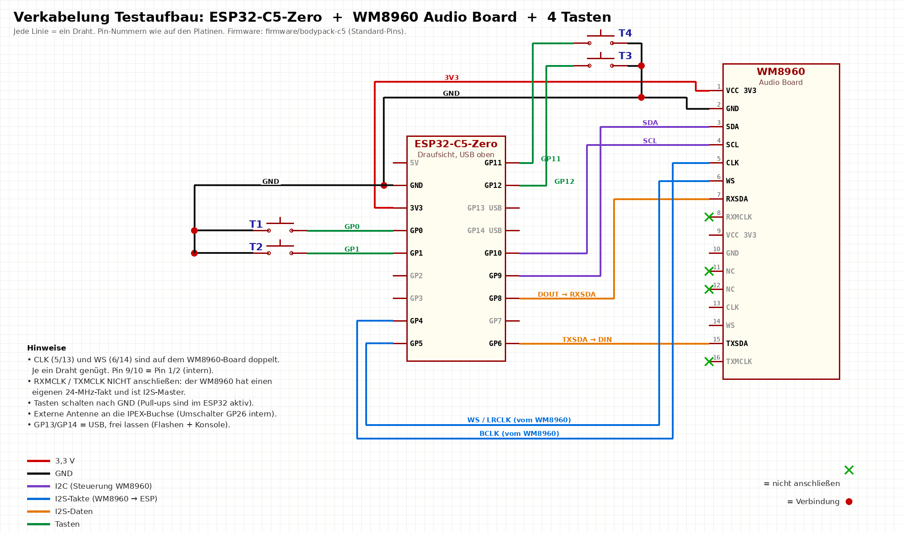

# Bodypack-Firmware ESP32-C5 (Phase 1: Hardware- und Funktest)

Diese Firmware läuft auf dem **Waveshare ESP32-C5-Zero** zusammen mit dem vorhandenen **Waveshare WM8960 Audio Board**.
Damit lässt sich testen:

- **Audio:** Mikrofon → Kopfhörer (`loop`), Testton (`tone`)
- **WLAN 5 GHz:** Verbindung, Signalstärke, AP-Wechsel, Antenne intern/extern
- **Funk-Messung:** Umlaufzeit, Schwankung und Paketverlust zum PC (`nettest`)
- **Audio über WLAN:** Mikrofon → PC und PC → Kopfhörer als RTP mit **Opus** (48 kHz, Payload-Typ 111 wie NR_Com) oder unkomprimiert (L16)
- **Messwerte:** Opus-Rechenzeit, freier RAM, Jitter, Verluste, FEC
- **4 Tasten** und RGB-LED

## 1. Verkabelung Testaufbau



*Jede Linie ist ein Draht (erzeugt mit `tools/wiring_diagram.py`).*


| WM8960 Audio Board | ESP32-C5-Zero | Hinweis |
|---|---|---|
| VCC (3V3) | **3V3** | |
| GND | **GND** | |
| SDA | **GP9** | |
| SCL | **GP10** | |
| CLK (Pin 5 oder 13) | **GP4** | Takt kommt vom WM8960 |
| WS (Pin 6 oder 14) | **GP5** | Takt kommt vom WM8960 |
| TXSDA (Pin 15) | **GP6** | Mikrofon-Daten zum ESP |
| RXSDA (Pin 7) | **GP8** | Kopfhörer-Daten zum WM8960 |
| RXMCLK / TXMCLK | **nicht anschließen** | Der WM8960 hat seinen eigenen 24-MHz-Takt |

| S3-Display (UART, 115200 Baud) | ESP32-C5-Zero | Hinweis |
|---|---|---|
| GPIO4 (TX) | **GP3** (RX) | Befehle vom Display |
| GPIO10 (RX) | **GP2** (TX) | Status und Pegel zum Display |
| GND | **GND** | gemeinsame Masse |

| Taste (schaltet nach GND) | ESP32-C5-Zero | Testfunktion |
|---|---|---|
| Taste 1 | **GP0** | Talk (halten) |
| Taste 2 | **GP1** | Modus wechseln: off → loop → tone → rtp |
| Taste 3 | **GP12** | Mikrofon wechseln: Board ↔ Buchse |
| Taste 4 | **GP11** | Status ausgeben |

- Die RGB-LED auf dem Board zeigt den Modus: grün = loop, blau = tone, türkis = rtp, rot = Talk, gelb blinkend = kein WLAN.
- Externe Antenne am IPEX-Anschluss: Die Firmware schaltet per Standard auf **extern** (`ant ext`).
  Welcher Pegel an GP26 die externe Antenne wählt, ist noch nicht bestätigt. Siehe Test 3.
- Alle Pins lassen sich in `idf.py menuconfig` → **NR Bodypack → Pins** ändern.

**Headset am WM8960-Board:** Die 3,5-mm-Buchse ist für 4-polige Handy-Headsets gedacht.
Für das **BPHS1** brauchst du einen Adapter von XLR (Mikrofon) und 6,35 mm (Kopfhörer) auf 3,5 mm 4-polig (CTIA).
Das BPHS1-Mikrofon ist dynamisch und braucht viel Verstärkung: `mic jack 30 3`.
Auf dem WM8960-Board liegt eine feste Mikrofonspeisung. Für einen kurzen Test mit dem dynamischen Mikrofon ist das unkritisch,
die richtige Lösung kommt mit der eigenen Platine.

## 2. Flashen

### Variante 0: Doppelklick (Windows mit Arduino IDE)
1. Arduino IDE: Paket **„esp32 by Espressif“ ab Version 3.3** (ältere esptool-Versionen kennen den C5 nicht).
2. C5-Zero per USB-C anschließen, seriellen Monitor schließen.
3. **`firmware/flash-c5.bat`** doppelklicken, COM-Port wählen.

### Variante A: fertige Datei, ohne Entwicklungsumgebung
1. Chrome oder Edge öffnen: <https://espressif.github.io/esptool-js/>
2. ESP32-C5-Zero per USB-C anschließen → **Connect** (bei Problemen BOOT-Taste halten und dann Reset drücken)
3. Datei `firmware/bin/nr-bodypack-c5.bin` mit **Flash Address 0x0** auswählen → **Program**
4. Danach im Terminal derselben Seite (115200 Baud) oder mit einem anderen seriellen Terminal arbeiten

### Variante B: selbst bauen (ESP-IDF 5.5)
Die Opus-Bibliothek ist ein Git-Submodul und muss einmal mitgeholt werden:
```bash
git submodule update --init
cd firmware/bodypack-c5
idf.py set-target esp32c5
idf.py build flash monitor
```

## 3. Erste Schritte in der Konsole

```text
help                          alle Befehle
status                        Zustand: WLAN, Audio, RTP, Speicher
wifi MeinNetz MeinPasswort    WLAN setzen (wird gespeichert)
band 5g                       nur 5 GHz (Standard), "auto" oder "2g" zum Vergleich
scan                          Netze in der Umgebung mit Kanal und Signalstärke
```

## 4. Tests

### Test 1: Audio lokal
```text
mode loop                 Mikrofon -> Kopfhörer
mic board 0 1             Board-Mikrofon, PGA 0 dB, Boost +13 dB
mic jack 20 2             Headset an der Buchse
vol 60                    Lautstärke
mode tone                 1-kHz-Testton
pegel                     Pegel live: erst still sein (= Grundrauschen), dann sprechen
gate -50                  Mikrofon-Gate: Schwelle ca. 6-10 dB ueber dem Grundrauschen, 'gate off' = aus
```
Mikrofon -> Kopfhörer dauert ca. 5-6 ms (I2S-Blöcke 1 ms, 4 Puffer je Richtung).
Erwartung: klarer Ton ohne Rauschen und Pfeifen. `status` zeigt den Pegel (Mic dBFS) und `I2S-Fehler 0`.
Wenn „kein I2S-Takt vom WM8960“ erscheint: CLK/WS-Leitungen und die I2C-Verbindung prüfen.

### Test 2: Funk-Messung
Auf dem PC (Python 3, im selben Netz, Server-PC per Kabel):
```bash
python tools/udp_echo.py
```
Am Bodypack:
```text
nettest 192.168.1.10                  IP des PCs, 10 s, 50 Pakete/s
nettest 192.168.1.10 5007 60 10       60 s mit 100 Paketen/s (wie 10-ms-Audio)
```
Ausgabe pro Sekunde: Verlust, Umlaufzeit (RTT min/avg/max), Jitter, Signalstärke.
**Damit geht man die Location ab.** Richtwerte: RSSI besser als −67 dBm, Verlust < 1 %, RTT avg < 10 ms.

### Test 3: Antenne intern/extern
```text
ant int        dann: status (RSSI ablesen)
ant ext        dann: status
```
Mit angeschlossener externer Antenne muss `ant ext` das deutlich bessere Signal zeigen.
Ist es umgekehrt, ist der Pegel vertauscht: In `menuconfig` unter **NR Bodypack → Pegel für externe Antenne** auf 0 stellen.

### Test 4a: Opus lokal (ohne Netz)
```text
rtp 127.0.0.1 5004         Pakete an sich selbst schicken (Opus-Encoder -> Decoder)
mode rtp
side 0
opus 48 5 lowdelay         48 kbit/s, Komplexitaet 5, geringste Latenz
```
Taste 1 halten und sprechen: Man hört sich über den Opus-Codec. Danach `status`:
- **CPU: Opus-Encoder / Decoder in µs pro Paket.** Bei 10-ms-Paketen sollte der Encoder deutlich unter 10.000 µs liegen.
- **Stack: Codec-Task frei.** Sollte über 2.000 Byte bleiben.
- **RAM: frei / minimal.** Sollte über 20.000 Byte bleiben.

Zum Vergleich: `opus 48 10 lowdelay`, `opus 32 5 voip`, `rtp frame 20`. Bitte die Werte notieren.

### Test 4: Echo über WLAN (eigene Stimme über das Netz)
PC: `python tools/udp_echo.py` läuft. Am Bodypack:
```text
rtp 192.168.1.10 5006      Ziel = PC, Echo-Port
mode rtp
side 0                     Mithörton aus (sonst hört man sich doppelt)
```
**Taste 1 halten und sprechen.** Man hört die eigene Stimme zurück, mit der Verzögerung Funk hin + zurück + Jitterbuffer.
Mit `rtp jb 20` / `rtp jb 60` lässt sich der Jitterbuffer verändern. `status` zeigt Verluste und Jitter.

### Test 5: Audio zum PC und vom PC (GStreamer)
Dafür `udp_echo.py` beenden, weil Port 5006 belegt ist. Am Bodypack: `rtp <pc-ip> 5006`, `mode rtp`.

Bodypack → PC (Lautsprecher am PC), **Opus**:
```bash
gst-launch-1.0 udpsrc port=5006 caps="application/x-rtp,media=audio,clock-rate=48000,encoding-name=OPUS,payload=111" ! rtpjitterbuffer latency=30 ! rtpopusdepay ! opusdec ! audioconvert ! audioresample ! autoaudiosink
```

PC → Bodypack (Testton in den Kopfhörer), **Opus**:
```bash
gst-launch-1.0 audiotestsrc is-live=true wave=sine freq=440 volume=0.3 ! audioconvert ! audioresample ! audio/x-raw,rate=48000,channels=1 ! opusenc bitrate=48000 frame-size=10 ! rtpopuspay pt=111 ! udpsink host=<BODYPACK-IP> port=5004
```

Unkomprimiert (L16) zum Vergleich: am Bodypack `rtp codec l16` (immer 5-ms-Pakete).
```bash
gst-launch-1.0 udpsrc port=5006 caps="application/x-rtp,media=audio,clock-rate=48000,encoding-name=L16,channels=1,payload=96" ! rtpjitterbuffer latency=30 ! rtpL16depay ! audioconvert ! audioresample ! autoaudiosink
gst-launch-1.0 audiotestsrc is-live=true wave=sine freq=440 volume=0.3 ! audioconvert ! audioresample ! audio/x-raw,format=S16BE,rate=48000,channels=1 ! rtpL16pay pt=96 min-ptime=5000000 max-ptime=5000000 ! udpsink host=<BODYPACK-IP> port=5004
```

## 5. Was die Ergebnisse uns sagen

Bitte die Ausgaben von `status` und `nettest` (aus verschiedenen Entfernungen) zurückschicken. Daraus ergeben sich:
- ob 5 GHz mit dem ESP32-C5 stabil genug ist (Verlust, Jitter)
- wie groß der Jitterbuffer sein muss (direkt Latenz)
- wie weit die Bodypacks vom AP weg dürfen
- ob die interne Antenne reicht oder die externe nötig ist

## Speicher (wichtig für das C5-Zero ohne PSRAM)
Beim Start sind ca. 170 KB RAM frei. WLAN, Opus-Encoder (ca. 25 KB) + Decoder (ca. 18 KB) und der Codec-Task (32 KB Stack) passen hinein.
Encoder und Decoder laufen deshalb in **einem** gemeinsamen Task.
Wenn `status` beim minimalen freien RAM unter 10.000 Byte fällt, auf ein C5-Board mit PSRAM wechseln (z. B. mit ESP32-C5-WROOM-1U-N8R8). Die Firmware läuft dort unverändert.

## Noch nicht enthalten (nächste Schritte)
- Anbindung an NR_Com (Login, Socket.IO, PlainTransport), sobald der Com-Dev das Server-Event fertig hat
- ~~Verbindung zum ESP32-S3-Display-Board (UART)~~ erledigt: Menü „Bodypack-Einstellungen“ am S3
