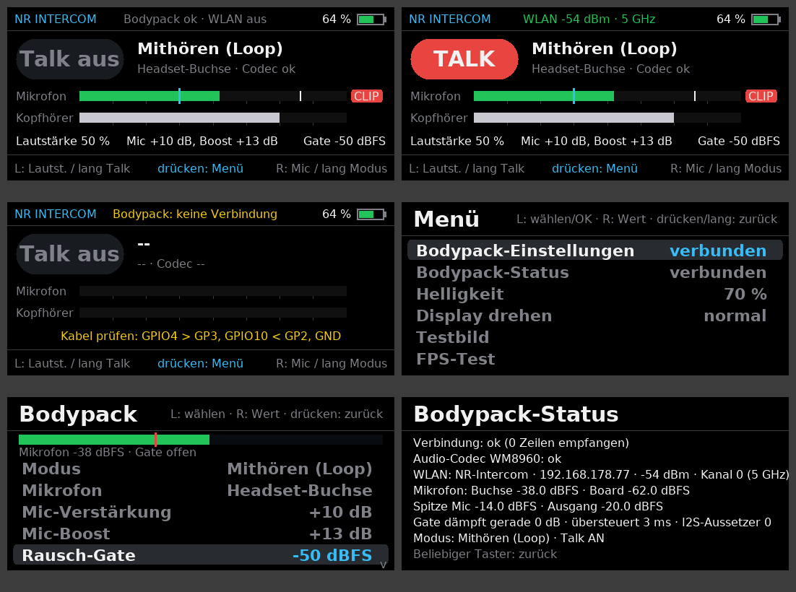
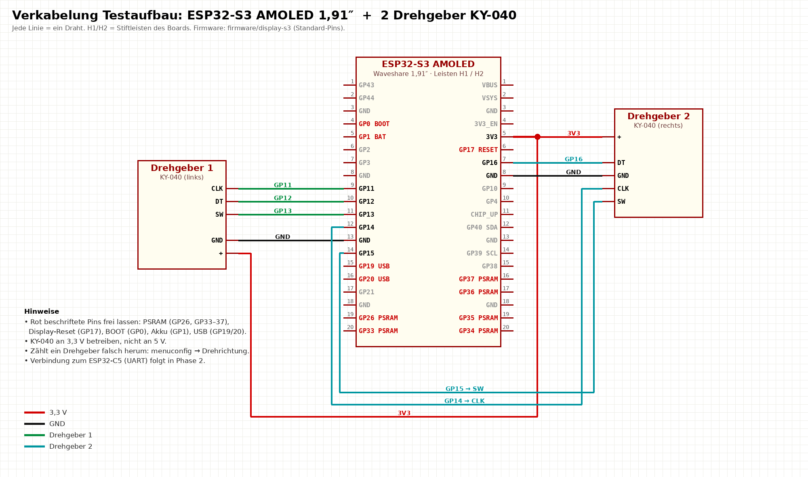

# Display-Firmware ESP32-S3 AMOLED (Phase 1: Display- und Bedientest)

Diese Firmware läuft auf dem **Waveshare ESP32-S3 AMOLED 1,91″** (RM67162, 536 × 240) und testet:

- **Display:** Ansteuerung über QSPI, Farben, Ausrichtung, Helligkeit, Bildrate
- **Drehgeber 1 + 2** (KY-040) inklusive Taster, kurz und lang gedrückt
- **Akkuspannung** (GPIO1)
- eine **Demo-Oberfläche** für das Intercom mit 4 Kanälen

Die Verbindung zum ESP32-C5 (Funk und Audio) folgt in Phase 2. Bis dahin zeigt die Kopfzeile „Funk: nicht verbunden“.



*Vorschau, am PC aus genau diesem Code gerendert: Hauptseite, Menü, Info, Testbild, FPS-Test.*

## 1. Verkabelung




Nichts umlöten: Die Drehgeber bleiben, wie sie laut dem bisherigen Sketch im NR_Com-Repo schon verdrahtet sind.

| Drehgeber | Pin | ESP32-S3 | Leiste |
|---|---|---|---|
| Drehgeber 1 | CLK | GPIO11 | H1 Pin 9 |
| Drehgeber 1 | DT | GPIO12 | H1 Pin 10 |
| Drehgeber 1 | SW | GPIO13 | H1 Pin 11 |
| Drehgeber 2 | CLK | GPIO14 | H1 Pin 12 |
| Drehgeber 2 | DT | GPIO16 | H2 Pin 7 |
| Drehgeber 2 | SW | GPIO15 | H1 Pin 14 |
| beide | + / GND | 3V3 / GND | H2 Pin 5 / GND |

- Wenn ein Drehgeber falsch herum zählt: in `menuconfig` → **NR Display → Drehgeber → Drehrichtung umkehren**.
- Wenn er pro Rastung zwei Schritte macht oder nur jede zweite Rastung zählt: **Zählschritte pro Rastung** auf 2 oder 4 stellen.
- Das WM8960-Board kann am S3 abgesteckt bleiben. Audio übernimmt künftig der C5.

### Verbindung S3 ↔ C5 (UART, 115200 Baud)

| ESP32-S3 (Display) | ESP32-C5-Zero | Signal |
|---|---|---|
| GPIO4 (H2 Pin 10) | **GP3** | S3 sendet → C5 empfängt |
| GPIO10 (H2 Pin 9) | **GP2** | C5 sendet → S3 empfängt |
| GND | **GND** | gemeinsame Masse (Pflicht) |

Über ein Kreuz verbinden: TX des einen auf RX des anderen. Beide Boards bleiben per USB versorgt; 3V3 **nicht** verbinden.

## 2. Flashen

### Variante 0: Doppelklick (Windows mit Arduino IDE)
1. In der Arduino IDE muss das Paket **„esp32 by Espressif“** installiert sein (Werkzeuge → Board → Boardverwalter).
2. S3-Board per USB-C anschließen. Den **seriellen Monitor der Arduino IDE schließen**, er blockiert sonst den Port.
3. **`firmware/flash-s3.bat`** doppelklicken. Das Skript findet esptool selbst, zeigt die COM-Ports und fragt nach dem Port.
   Bei nur einem Gerät genügt Enter.
4. Klappt es nicht: BOOT-Taste halten, kurz RESET drücken, BOOT loslassen und mit „j“ neu versuchen.

### Variante A: fertige Datei im Browser
1. Chrome oder Edge öffnen: <https://espressif.github.io/esptool-js/>
2. S3-Board per USB-C anschließen → **Connect** (bei Problemen BOOT-Taste halten und Reset drücken)
3. `firmware/bin/nr-display-s3.bin` mit **Flash Address 0x0** → **Program**

### Variante B: selbst bauen (ESP-IDF 5.5)
```bash
cd firmware/display-s3
idf.py set-target esp32s3
idf.py build flash monitor
```

## 3. Bedienung

| | Drehgeber 1 (links) | Drehgeber 2 (rechts) |
|---|---|---|
| **Hauptseite (Bodypack-Übersicht)** | Drehen: Kopfhörer-Lautstärke · kurz: Menü · lang: Talk an/aus | Drehen: Mic-Verstärkung · kurz: Menü · lang: nächster Modus |
| **Menü** | Drehen: Eintrag wählen · kurz: ausführen · lang: zurück | Drehen: Wert ändern (Helligkeit) · kurz: zurück |
| **Bodypack-Einstellungen** | Drehen: Eintrag wählen · kurz: nächster Wert (bei Auswahllisten) · lang: zurück | Drehen: Wert ändern (geht sofort an den C5) · kurz: zurück |
| **Bodypack-Status** | kurz: zurück | kurz: zurück |
| **Info / Testbild / FPS-Test** | kurz: zurück | kurz: zurück |

Helligkeit und Ausrichtung werden gespeichert. Die Bodypack-Einstellungen speichert der C5 selbst (2 s nach der letzten Änderung).

**Bodypack-Einstellungen:** Modus (Aus / Mithören / Testton / Funk), Mikrofon (Board / Headset), Mic-Verstärkung, Mic-Boost,
Rausch-Gate, Kopfhörer, Mithörton, Talk-Taste (halten / umschalten), WLAN-Band, Antenne, Codec, Opus-Bitrate, Paketlänge, Jitterbuffer.
Oben läuft eine Pegelanzeige des Mikrofons mit (−80 … 0 dBFS); der rote Strich ist die Gate-Schwelle. Gate richtig eingestellt:
in Sprechpausen bleibt der Balken links vom Strich (grau = Gate zu), beim Sprechen geht er darüber (grün = offen).
Ein gelber Wert ist zum C5 geschickt, aber noch nicht bestätigt. WLAN-Name und Passwort setzt man weiter über die USB-Konsole des C5.

**Hauptseite:** Talk, Modus, Mikrofon, Pegel von Mikrofon und Kopfhörer (weißer Strich = Spitze, blauer Strich = Gate-Schwelle,
roter **CLIP** = Mikrofon übersteuert → Mic-Verstärkung zurückdrehen), Lautstärke, Verstärkung und Gate.

## 4. Was bitte prüfen

1. **Testbild:** Oben links ist die weiße Leiste, die Farben sind in der Reihenfolge weiß, gelb, cyan, grün, magenta, rot, blau, schwarz.
   Wenn alles auf dem Kopf steht: Menü → **Display drehen**.
   Wenn die Farben falsch sind (z. B. rot und blau vertauscht), bitte ein Foto schicken.
2. **Verläufe** im Testbild laufen gleichmäßig ohne Streifen oder Sprünge.
3. **FPS-Test:** Wie viele Bilder pro Sekunde werden angezeigt, und läuft der blaue Balken flüssig?
   Erwartung: etwa 30–60 FPS bei vollem Bild.
   Bei Bildfehlern in `menuconfig` den **QSPI-Takt** von 75 auf 40 MHz senken.
4. **Drehgeber:** Jede Rastung bewegt die Auswahl genau um einen Schritt, ohne Springen. Kurz und lang drücken werden sauber unterschieden.
5. **Info-Seite:** Akkuspannung plausibel? Mit USB und ohne Akku erscheint meist „USB“ oder ein Wert um 4,2–5 V.
